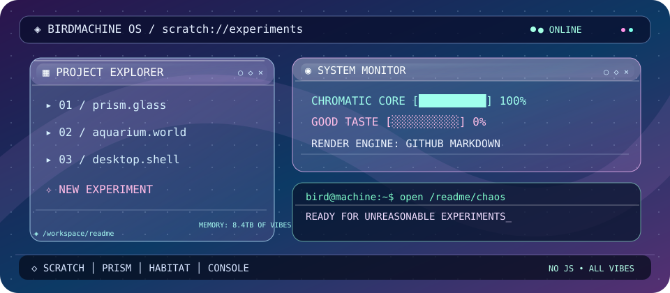

# 🦜 Living README Laboratory

<p align="center"></p>

<p align="center"><b>THREE WORLDS · ONE README · ZERO JAVASCRIPT</b></p>

<p align="center">💎 <a href="#01-holographic-glass">REFRACTION ENGINE</a>　 ·　 🐟 <a href="#02-a-little-living-terrarium">MICRO AQUARIUM</a>　 ·　 🖥️ <a href="#03-a-readme-disguised-as-a-desktop">GLASS DESKTOP</a></p>

Three experiments in making a **GitHub README feel like an animated application** without script tags, injected CSS or iframes.

[🏠 Main Scratch README](../../README.md) · [💎 Glass](#01-holographic-glass) · [🐟 Terrarium](#02-a-little-living-terrarium) · [🖥️ Desktop](#03-a-readme-disguised-as-a-desktop)

> [!IMPORTANT]
> These visuals are **SVG/SMIL render experiments**. Browser, GitHub image proxy and reduced-motion settings can change animation behavior. The aquarium's **Issue/Action-driven persistence is coded on this branch**, but requires merging and a successful real issue run before it is live. The desktop is a visual metaphor with *real Markdown links* underneath.

## 01 · Holographic glass

<p align="center">
  
</p>

A GitHub-friendly approach to a floating refractive-looking prism: translucent polygon faces, chromatic gradient strokes, background glow, overlapping waves and self-contained SVG animation.

<details>
<summary>💎 Open the prism's instrument panel</summary>

| Material | Technique | Notes |
|---|---|---|
| Faceted glass | SVG paths + opacity | Simulated refraction; *not* physical refraction |
| Chromatic edge | Multistop gradient | Pink → cyan → violet |
| Floating motion | SMIL `animateTransform` | Fallback is static |
| Haze | Gaussian blur + radial gradient | Small blur region for performance |
| Scope | Image only | Does not restyle GitHub's page |

[Inspect the prism SVG](./assets/holographic-glass.svg)

</details>

## 02 · A little living terrarium

<p align="center">
  
</p>

Our aquarium lives entirely inside one SVG. The betta glides, its tail deforms, and bubbles rise. This is **visual phase one**: no external API, Action, or write permission required.

<details>
<summary>🐟 Open the fishkeeper's notebook</summary>

**Experimental persistent controls are now implemented on this branch**: a constrained [GitHub Issue Form](../../.github/ISSUE_TEMPLATE/aquarium.yml) and [GitHub Actions workflow](../../.github/workflows/aquarium.yml) can accept three fixed actions: feed the betta, moonlight, or daylight. A standard-library [Python renderer](./update_aquarium.py) regenerates a state HUD on the SVG and saves the JSON aquarium state. User text is never copied into the SVG, and the script does not execute user-provided code.

**Activation caveat:** `issues` workflows and issue templates must exist on the default branch to work. Until this draft PR is merged, the aquarium remains a non-interactive animation. After merge, use [the new issue chooser](https://github.com/BirdMachine/Scratch/issues/new/choose) to feed the fish or change lights. Branch-protection rules, Actions policy, and workflow permissions may still prevent the automated commit; test in a live issue.

**Security caveat:** all public issue authors can trigger the finite preset actions. The script accepts only the three enumerated choices. Public issues can still generate workflow runs, so rate limits or authorization can be added if needed.

[Inspect the terrarium SVG](./assets/readme-terrarium.svg)

</details>

## 03 · A README disguised as a desktop

<p align="center">
  
</p>

This is a mock OS shell made from SVG. For **actual clicks**, use Markdown links and GitHub-native `details` immediately below the visual: GitHub strips arbitrary JavaScript and most styling.

| ◈ Dock | Launch |
|:---|:---|
| 💎 Prism | [Open the glass module](#01-holographic-glass) |
| 🐟 Habitat | [Open the aquarium module](#02-a-little-living-terrarium) |
| 🧪 Scratch | [Return to the original laboratory](../../README.md) |

<details>
<summary>🗔 TERMINAL.EXE · click to open</summary>

```text
bird@machine:~$ cat /etc/motd
WELCOME TO BIRDMACHINE OS
  renderer: GitHub-flavored Markdown
  animations: SVG / SMIL (viewer-dependent)
  executable JS in README: denied
  practical weirdness: unlimited
bird@machine:~$ _
```

</details>

<details>
<summary>🗔 SYSTEM SETTINGS · click to open</summary>

- **Theme:** cyber-glass, raspberry plasma, aqueous cyan
- **Surface:** simulated transparency within the image, not through GitHub UI
- **Controls:** native links and disclosure widgets
- **Accessibility:** captions and alt text; motion-sensitive users can open static content or use browser motion preferences

</details>

---

### Experimental checklist

- [x] Three authored standalone SVG specimens
- [x] Animated primitive shapes with static fallback
- [x] A GitHub-native navigation / disclosure layer
- [ ] Verify SVG animations against GitHub's live README image rendering
- [ ] Explore dark/light-specific `picture` variants
- [x] Add an opt-in Issue Form and a constrained Actions-backed habitat prototype (activation requires merge)
- [ ] Verify an actual issue updates the live aquarium

> [!TIP]
> A README cannot host an arbitrary web app. If we eventually want drag-and-drop windows, live sliders and physically accurate shaders, put that component on **GitHub Pages** and embed a still/animated preview with a link to launch the experience.

## 🧷 Showpiece safety and operational notes

The GitHub-hosted version is intentionally a *native README* first: SVG illustrations and GitHub Markdown, with no custom scripts. The image rendering pipeline may freeze SMIL motion; the static SVGs are designed to remain meaningful.

**For a real visitor-triggered aquarium update**, the Issue Form and workflow must be on `main`. The workflow uses finite commands only, but public issue creation can trigger runs. Before shipping, consider rate limiting or an explicit approval rule, validate the first GitHub Actions write under branch protection, and audit the history. The GitHub Pages route remains an optional separate full-interaction experience, not something the README itself executes.
